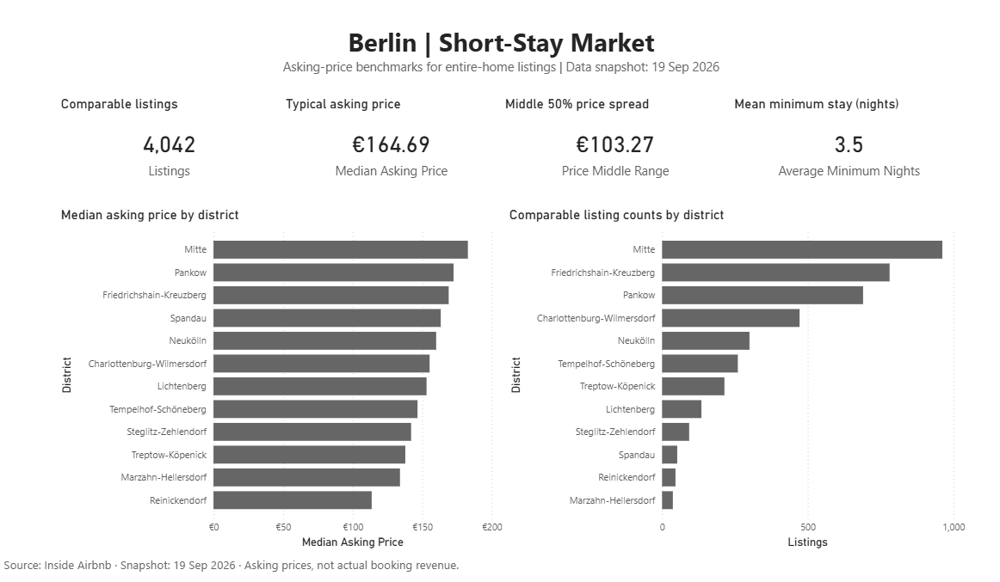
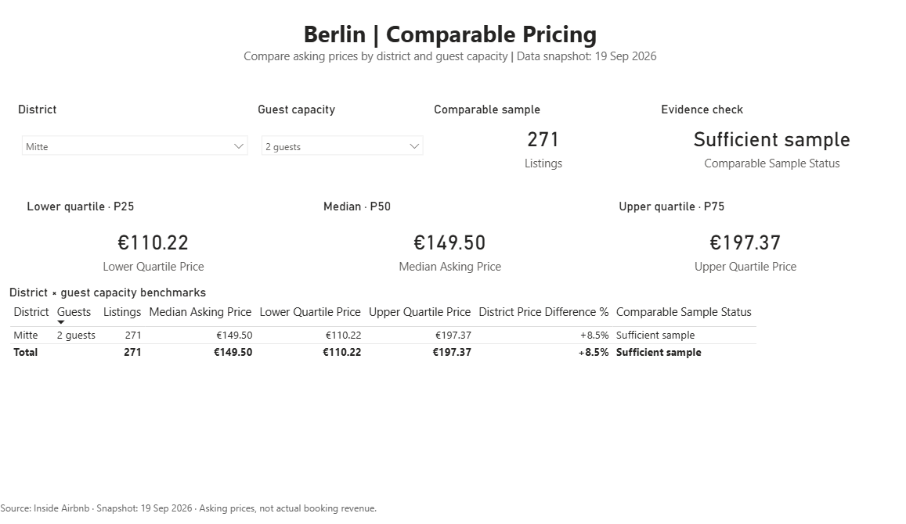

# Berlin Hospitality Market Intelligence

A Power BI dashboard for comparing short-term accommodation prices across Berlin.

I built this project to help accommodation operators compare their advertised nightly rates with similar properties. Instead of relying on a citywide average, the report focuses on district, guest capacity and the number of comparable listings.

## Dashboard

### Berlin market overview



### Comparable pricing



## Key findings

I analysed **12,376 Berlin Airbnb listings** from 19 September 2026. After applying the eligibility rules, **4,042 listings** remained across 12 districts.

- **Mitte leads the market in this sample.** It had the highest median asking price (€182.80) and the largest number of eligible listings (962).
- **Spandau ranks fourth in asking price.** Its median was €163.30, but with only 52 eligible listings, the benchmark is based on a relatively small comparison group.
- **Missing prices are a major data-quality finding.** 4,219 listings (34.1%) had no recorded price. Most of them (3,374) also showed zero available days over the next year, suggesting unavailable inventory may help explain the missing prices.

Across the eligible listings, the median asking price was **€164.69 per night**.

## How I built it

**Stack:** Python · SQLite · SQL · Power Query · Power BI · DAX

I used the [Inside Airbnb Berlin dataset](https://insideairbnb.com/get-the-data/) and focused on entire-home listings for 1–6 guests, with asking prices between €30 and €500 and minimum stays of 1–30 nights.

The Python pipeline downloads the dataset, applies the filtering rules and records why listings were excluded. SQLite stores the cleaned data and exclusion audit, while SQL checks verify record counts, unique identifiers and relationships before exporting the reporting tables.

In Power BI, I built a small star schema with one fact table, two dimensions and ten DAX measures. The two report pages show district-level comparisons and P25, median and P75 asking prices for a selected district and guest capacity, with a warning when fewer than 20 listings are available.

One measure used for district comparisons:

```dax
City Median Price =
    CALCULATE(
        [Median Asking Price],
        REMOVEFILTERS(DimDistrict)
    )
```

This removes the district filter while keeping the selected guest capacity, so each district can be compared with the citywide median for properties of the same capacity.

## Run locally

**Requirements:** Python 3.10+ and Power BI Desktop. No additional Python packages are required.

1. Clone the repository and open a terminal in the project folder.
2. Run the automated tests:

   ```powershell
   py -m unittest discover -s tests -v
   ```

3. Download and process the Berlin data:

   ```powershell
   py -m pipeline.build_market
   ```

4. Check `build/quality_report.json` for the reconciliation results.
5. Open `powerbi/Berlin_Hospitality/Berlin_Hospitality.pbip` in Power BI Desktop.
6. Under **Transform data → Manage parameters**, set `pDataFolder` to the absolute path of your local `build` folder. Apply the changes and refresh the report.

For the selected snapshot, a successful run produces **4,042 eligible listings**, with all reconciliation checks passing.

The pipeline rebuilds a fixed data snapshot; it does not automatically retrieve new market observations.

## Limitations

- Asking prices are advertised rates, not confirmed booking prices or revenue.
- District and guest capacity do not capture every difference in property quality, amenities or location.
- The analysis covers one snapshot and cannot establish market trends or seasonal changes.

## Data and license

**Data source:** [Inside Airbnb — Berlin, 19 September 2026](https://insideairbnb.com/get-the-data/)

The underlying Inside Airbnb data is licensed under CC BY 4.0.

**Project code:** MIT License. See [LICENSE](LICENSE).